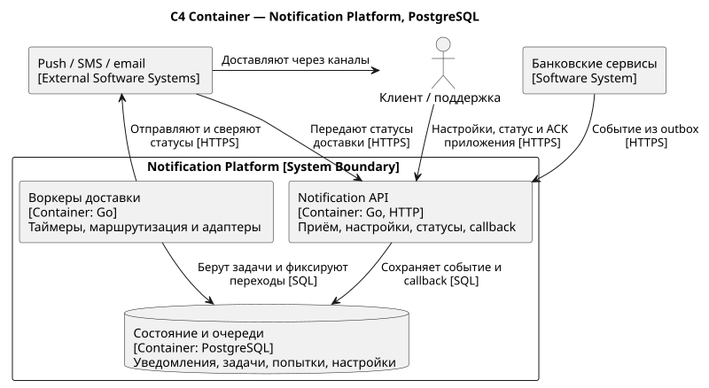
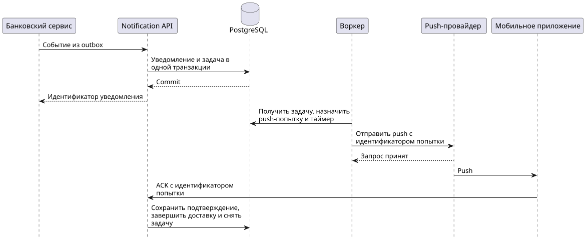
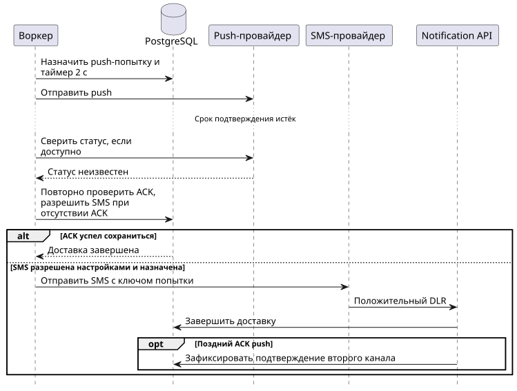
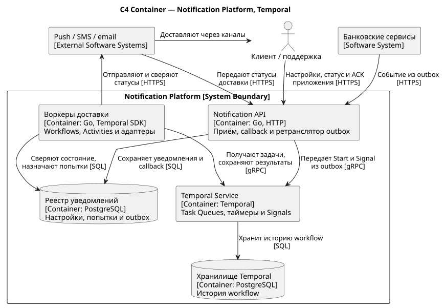
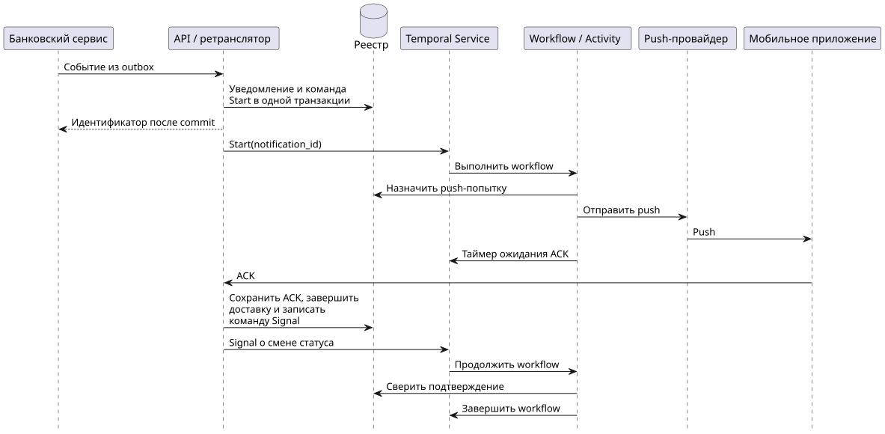
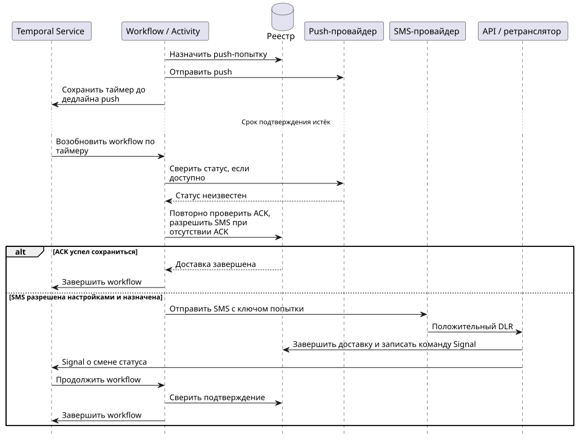

# RFC: Гарантированная доставка критичных уведомлений с автоматическим переключением между каналами

| Метаданные | Значение |
|------------|----------|
| **Статус** | DRAFT |
| **Автор(ы)** | Фёдор Шатохин |
| **Ответственный** | Команда Notification Platform (предлагается) |
| **Бизнес-заказчик** | Владелец продукта онлайн-банка (предлагается) |
| **Ревьюеры** | Представители команд платежей, мобильного банка и SRE (предлагаются) |
| **Дата создания** | 2026-11-15 |
| **Дата обновления** | 2026-11-15 |

## Оглавление

1. [Контекст](#контекст)
2. [Продуктовый анализ](#продуктовый-анализ)
3. [Пользовательские сценарии](#пользовательские-сценарии)
4. [Статистика](#статистика)
5. [Требования](#требования)
6. [Варианты решения](#варианты-решения)
7. [Сравнительный анализ](#сравнительный-анализ)
8. [Выводы](#выводы)
9. [Связанные задачи](#связанные-задачи)
10. [Приложения](#приложения)

## Контекст

Команды онлайн-банка самостоятельно отправляют уведомления об оплатах, переводах, банковских продуктах и акциях. Из-за разных правил отправки клиенты получают сообщения с задержкой или несколько раз, а поддержка с трудом выясняет, где произошёл сбой. Задержка сообщения о списании сокращает время, за которое клиент может заметить подозрительную операцию.

Notification Platform принимает транзакционные, сервисные и маркетинговые сообщения и доставляет их через push, SMS и email. Требования ниже охватывают платформу целиком. Архитектурные варианты детализируют только доставку транзакционных уведомлений, включая её изоляцию от массовых кампаний. Исполнение банковских операций и управление аудиториями кампаний находятся за рамками RFC.

## Продуктовый анализ

| Бизнес-цель | Критерий оценки | Вклад платформы |
|-------------|-----------------|-----------------|
| Увеличить retention на 15% | Рост D30 retention на 15% относительно контрольной группы. Для сравнения используются сопоставимые когорты клиентов, совершивших первую операцию | Своевременные статусы операций и релевантные сервисные напоминания |
| Снизить количество жалоб на 30% | Сокращение месячного числа жалоб на задержки, недоставку и дубли на 30% к среднему за три месяца до запуска. Частота на 100 тыс. уведомлений контролируется отдельно | Автоматический failover, подавление дублей и история доставки для поддержки |
| Гарантировать доставку критичных уведомлений | Ни одно событие, принятое платформой, не теряется при отказе одной зоны. Не менее 99,9% получают подтверждение доставки за 5 минут в скользящем окне 30 дней | Сохранение события, автоматическое переключение, повторные попытки и эскалация |

Эффект для retention оценивается при поэтапной миграции относительно клиентов на действующем процессе доставки. В эксперименте обе группы продолжают получать критичные уведомления.

Гарантия доставки действует при наличии хотя бы одного разрешённого канала, который доступен в пределах окна повторов и способен подтвердить доставку. При недоступности всех каналов платформа сохраняет событие и историю попыток, поднимает инцидент и фиксирует исчерпание окна. Такой исход учитывается как недоставка при расчёте SLO. Клиент может отключать категории сервисных и маркетинговых сообщений и исключать отдельные каналы для транзакционных. Платформа сохраняет хотя бы один пригодный канал для критичных сообщений. Если последний подтверждённый контакт перестал работать, факт недоставки виден поддержке, а при следующем входе клиенту предлагают обновить контакт.

## Пользовательские сценарии

| Приоритет | Тип сценария | Действующее лицо | Сценарий |
|-----------|--------------|------------------|----------|
| MUST HAVE | Критичное уведомление | Клиент | После списания получает сообщение по выбранному каналу |
| MUST HAVE | Переключение канала | Клиент | При сбое push получает сообщение по следующему разрешённому каналу |
| MUST HAVE | Настройки | Клиент | Выбирает основной канал, меняет разрешённые резервные каналы и отключает ненужные категории сервисных и маркетинговых сообщений |
| MUST HAVE | Расследование | Поддержка | По идентификатору уведомления видит результат каждой попытки и причину переключения |
| SHOULD HAVE | Массовая отправка | Маркетолог | Запускает кампанию на миллион клиентов. Кампания учитывает согласия и соблюдает согласованное окно отправки |

## Статистика

| Показатель | Значение |
|------------|----------|
| MAU | 10 млн |
| DAU | 3 млн |
| Пользователи онлайн в пик | 300 тыс. |
| Сообщения на активного пользователя в день | 2 транзакционных, 3 сервисных, 5 маркетинговых |
| Максимальная аудитория одной кампании | 1 млн |

Объём рассчитан по DAU. Число одновременных пользователей не задаёт частоту операций, поэтому для предварительного расчёта используется коэффициент пика ×8. Его нужно проверить по фактическим данным.

## Требования

### Функциональные требования

| № | Приоритет | Обозначение | Требование |
|---|-----------|-------------|------------|
| 1 | MUST HAVE | FR1 | Платформа принимает транзакционные, сервисные и маркетинговые уведомления. Для каждого получателя определяет разрешённые каналы и показывает итог отправки |
| 2 | MUST HAVE | FR2 | Клиент выбирает предпочтительный канал и допустимые резервные. Для критичных уведомлений нельзя отключить доставку целиком или исключить последний пригодный канал. Для остальных категорий учитываются отключения и согласия |
| 3 | MUST HAVE | FR3 | При отказе или отсутствии подтверждения к сроку платформа автоматически пробует следующий разрешённый канал. После первого подтверждения прекращает новые попытки и фиксирует итог |
| 4 | MUST HAVE | FR4 | Повторное получение одного события для того же клиента не запускает повторную доставку. Платформа подавляет отменяемые дубли при переключении каналов |
| 5 | MUST HAVE | FR5 | Поддержка видит статус, каналы, время и причины попыток. При исчерпании окна доставки критичного сообщения платформа сигнализирует о недоставке |
| 6 | SHOULD HAVE | FR6 | Маркетолог может запустить кампанию до 1 млн получателей с учётом согласий и отслеживать её прогресс |
| 7 | MUST HAVE | FR7 | Платформа соблюдает предпочтение клиента. При равном предпочтении использует более дешёвый пригодный канал с учётом его состояния и срока доставки |

### Нефункциональные требования

| № | Приоритет | Обозначение | Требование |
|---|-----------|-------------|------------|
| 1 | MUST HAVE | NFR1 | Не менее 99% критичных уведомлений с пригодным основным каналом получают подтверждение в течение 5 с от сохранения платформой за 30 дней штатной работы. Состояние канала определяется мониторингом на момент приёма, пропавший ACK остаётся в выборке |
| 2 | MUST HAVE | NFR2 | Не менее 99,9% всех принятых критичных уведомлений получают подтверждение за 5 минут от сохранения в скользящем окне 30 дней. При отказе одной зоны RPO = 0 для принятых уведомлений, RTO ≤ 5 минут |
| 3 | MUST HAVE | NFR3 | На 30-минутном тесте платформа выдерживает 3 500 сообщений/с, включая 600 критичных/с, и до 2 000 критичных обращений к провайдерам/с при отказе канала. Кампания на 1 млн клиентов ставится в обработку за 30 минут при доступной фоновой квоте. NFR1 выполняется при одновременной кампании и штатном основном канале |
| 4 | MUST HAVE | NFR4 | 0 повторных логических уведомлений при повторной подаче идентичного события в течение 7 суток. Не более 0,1% принятых критичных уведомлений имеют подтверждения доставки из разных каналов за 30 дней |
| 5 | MUST HAVE | NFR5 | 100% критичных уведомлений имеют идентификатор и историю переходов и попыток в течение 7 суток. Алерт поступает дежурному за ≤ 2 минут, если старейшая критичная задача на первую отправку ждёт более 1 с или доля нарушений пятиминутного SLO превышает 1% за 15 минут |
| 6 | SHOULD HAVE | NFR6 | В штатном режиме при измерении за 30 дней не более 5 оплачиваемых SMS на 100 принятых критичных уведомлений для клиентов с пригодным push и без предпочтения SMS |
| 7 | MUST HAVE | NFR7 | 0 контактных данных, текстов уведомлений и реквизитов в операционных логах. 100% внешних подтверждений проходят аутентификацию по контракту провайдера перед применением |

**Расчёт нагрузок**

- Транзакционные уведомления: 3 млн × 2 = 6 млн/сутки ≈ 69/с в среднем и 556/с в пик. Сервисные: 9 млн/сутки ≈ 104/с. Маркетинговые: 15 млн/сутки ≈ 174/с.
- Итого 30 млн/сутки ≈ 347/с, пиковая оценка ≈ 2 780/с. Кампания на 1 млн за 30 минут добавляет до 556/с. При наложении на расчётный пик получается ≈ 3 336/с. Проектная нагрузка округлена до 3 500/с, из них до 600 критичных/с.
- При штатных долях перехода на второй канал 5% и на третий 1% получается 6,36 млн попыток в день, около 74/с. При массовом отказе трёх каналов 600 уведомлений/с × 3 первых попытки = 1 800 попыток/с. До 200/с оставлено на повторы и сверку статусов. При недостатке внешней квоты повторные задания откладываются с сохранением приоритета первых попыток.
- За 7 суток — около 42 млн ключей дедупликации и 44,5 млн записей попыток при штатном профиле. При допущении 1 КБ суммарных данных и индексов на уведомление и 0,5 КБ на попытку это около 64 ГБ на основной экземпляр. Для WAL, обслуживания индексов, журналов подтверждений и всплесков закладывается запас ×3, около 200 ГБ на экземпляр. Пространство Temporal рассчитывается отдельно по истории workflow пилота.
- При 3% оплачиваемых SMS от всех критичных сообщений получается около 180 тыс. SMS в день. При первом резерве SMS и полном отказе push теоретический поток может приблизиться к 600 SMS/с. Это основание для резервирования квот у провайдеров. Порог NFR6 измеряется отдельно на указанной в требовании когорте.

### Архитектурно значимые требования

| ASR | Приоритет | Связанные требования | Почему влияет на архитектуру | Архитектурные последствия |
|-----|-----------|----------------------|------------------------------|----------------------------|
| ASR1. Быстрая доставка в пик | MUST HAVE | FR1, FR6, NFR1, NFR3 | Кампании и медленные провайдеры могут занять общие ресурсы | Отдельная очередь критичных задач, резерв воркеров, изоляция пулов по каналу, ограничители фонового трафика |
| ASR2. Сохранность и автоматическое восстановление | MUST HAVE | FR3, FR5, NFR2 | Сбой возможен между сохранением события, отправкой и получением подтверждения | Долговечный приём, репликация по зонам, журнал попыток, сохраняемые таймеры и восстановление незавершённой доставки |
| ASR3. Подавление дублей | MUST HAVE | FR4, NFR4 | Повтор события, параллельные воркеры и поздние подтверждения требуют согласованных переходов | Уникальный ключ уведомления, атомарное назначение попытки, идемпотентная обработка подтверждений, сверка перед failover |
| ASR4. Настройки, стоимость и квоты | MUST HAVE | FR2, FR7, NFR3, NFR6 | Маршрут зависит от контактов, доступности и цены, а резервный канал может исчерпать квоту | Единая политика маршрутизации, версионирование настроек, контроль квот и состояния каждого канала |
| ASR5. Расследуемость и защита данных | MUST HAVE | FR5, NFR5, NFR7 | Поддержке нужна единая история из нескольких систем в условиях ограниченного доступа | Сквозной идентификатор, нормализация статусов, метрики и трассировка, разграничение доступа к контактам |

### Ключевые архитектурные вопросы

| Вопрос | Требования и ASR | Почему важен |
|--------|------------------|-------------|
| Где хранить состояние ожидания, попыток и таймеров? | FR3, NFR2, ASR2 | От места хранения зависит восстановление после падения воркера или потери зоны |
| Когда переходить на резерв после тайм-аута? | FR3, FR4, NFR1, NFR4, ASR2, ASR3 | Ранний переход уменьшает задержку и увеличивает вероятность дубля и расходы. Долгое ожидание откладывает доставку при сбое |
| Как изолировать транзакционный поток на входе и у общих провайдеров? | FR6, NFR3, ASR1, ASR4 | Даже раздельные очереди конкурируют за квоту провайдера и соединения к хранилищу |
| Какие подтверждения достаточны для завершения доставки? | FR3, FR5, NFR2, ASR2, ASR5 | От этого зависят момент переключения, сопоставимость SLO и точность диагностики |

### Архитектурные решения, которые не подходят

| Решение | Нарушаемые ASR | Причина |
|---------|----------------|---------|
| Синхронная отправка в обработчике банковской операции | ASR1, ASR2 | Задержки провайдера удерживают запрос операции. Сбой процесса между подтверждением операции и отправкой может потерять уведомление |
| Одновременная отправка по push, SMS и email для каждого события | ASR3, ASR4 | При доступных каналах клиент регулярно получит несколько копий, а SMS будет оплачиваться даже при успешном push |
| Общая FIFO-очередь с общим пулом воркеров для кампаний и критичных событий | ASR1 | Миллион задач кампании занимает очередь и ресурсы отправки, задерживая транзакционные события |

### Неопределённости и риски

| Что неизвестно | Риск | Как проверить |
|----------------|------|--------------|
| Задержки и достоверность ACK и DLR, поддержка поиска статуса и дедупликации у конкретных провайдеров | Ложный failover, дубли или подтверждения, сравнимые только внутри одного канала | Пилот с реальными устройствами, операторами и почтовыми системами. Сверить подтверждения на P95/P99, испытать потерю, задержку и повтор callback |
| Фактический пик критичных событий и квоты SMS при массовом отказе push | Превышение SLO несмотря на исправную платформу | Измерить пики по журналам банка, согласовать резервные квоты и проверить переход на резерв при 600 событиях/с |
| Доля клиентов без пригодного канала и с предпочтением SMS | Недоставка и расходы выше прогноза | Измерить доступность подтверждённых контактов и выбор каналов на пилоте, пересчитать SLO и бюджет |
| Время восстановления хранилища, число активных workflow и объём их истории | Долгое восстановление и рост издержек | Провести тест потери зоны под нагрузкой и 24-часовой прогон с контролируемой деградацией провайдеров |

## Варианты решения

### Общие правила доставки

1. Банковский сервис фиксирует событие в своём transactional outbox той же транзакцией, что и операцию. Ретранслятор повторяет приём в платформу до подтверждения. Платформа подтверждает приём после фиксации записи уведомления и задачи доставки в PostgreSQL с синхронной репликой в другой зоне. Уникальный ключ `(source, event_id, recipient_id)` возвращает идентификатор ранее принятого уведомления при повторе. Источник сохраняет идентификатор события при всех повторах.
2. Основной канал берётся из актуальных настроек. Остальные пригодные каналы ранжируются по доступности, ожидаемой скорости и цене. При равных условиях порядок push → email → SMS. До каждой новой попытки проверяются актуальные настройки, здоровье провайдера и доступная квота. Момент решения, версия настроек и причина записываются в историю.
3. Отправка проходит через записи `ПРИНЯТО → В ДОСТАВКЕ → ДОСТАВЛЕНО / ИСЧЕРПАНО`. У каждой попытки есть идентификатор, канал, время и результат. При штатной работе цель для P99 от приёма до первого обращения к провайдеру — ≤ 500 мс. При явном отказе переключение происходит сразу. Сетевой тайм-аут (стартовое значение 800 мс) означает неопределённый исход. Ожидание подтверждения на одну попытку начинается при её назначении и ограничено 2 с для push, 10 с для email и 20 с для SMS. Таймеры настраиваются по результатам пилота.
4. Push подтверждается ACK приложения после получения уведомления. SMS подтверждается финальным положительным DLR оператора. Email подтверждается событием провайдера о принятии письма почтовым сервером адресата. Это технические границы доставки, наблюдаемые платформой. Email-подтверждение измеряет передачу почтовой системе адресата. Факт чтения из этих сигналов неизвестен. Ответ на запрос отправки от любого провайдера сам по себе не завершает доставку.
5. Подтверждение коррелируется с попыткой по идентификатору провайдера или клиентскому ключу. Повторы callback подавляются, а подтверждение доставки имеет приоритет над запоздалым сообщением об ошибке. По таймеру платформа сверяет статус через API провайдера, если он доступен в пределах 500 мс. При отклонении, недоступности или сохранении неопределённости назначается резерв. Подтверждение и выдача разрешения на отправку изменяют запись уведомления под одной блокировкой. Резервная задача повторно проверяет результат перед получением разрешения. Сетевой вызов выполняется после фиксации разрешения, вне транзакции.
6. Для каждой попытки используется стабильный ключ отправки. При неопределённом исходе автоматический повтор той же попытки разрешён при договорной идемпотентности провайдера. В остальных случаях платформа запрашивает статус и переходит на другой канал по таймеру, сохраняя исходную попытку как неопределённую. После обхода каналов платформа повторно проверяет пригодность контактов, состояние каналов и статусы неопределённых попыток. Новые отправки возможны после явного временного отказа или по каналу, который ранее был недоступен и по которому нет неопределённой попытки. Эти проверки и повторы выполняются с экспоненциальной задержкой и случайным разбросом от 30 с до 30 мин до истечения 24 ч. После 5 минут без подтверждения событие учитывается в нарушениях SLO. По истечении 24 ч доставка получает статус «Исчерпано», а операторы получают запись для разбора. Поздний ACK обновляет историю и фактическое время подтверждения, сохраняя факт нарушения дедлайна.
7. Между выдачей разрешения и доставкой резерва результат первой попытки может проясниться. Платформа отменяет резерв до выдачи разрешения и запрашивает отмену уже выданной отправки, если провайдер её поддерживает. После передачи обоих сообщений независимым провайдерам возможны две доставки. Push-клиент подавляет повтор одного идентификатора. Метрика NFR4 измеряет наблюдаемый межканальный дубль по двум положительным подтверждениям. Потеря подтверждений может занижать эту оценку, поэтому пилот сверяет её с фактическим получением на тестовых контактах.
8. Критичные и фоновые потоки имеют раздельные бюджеты на соединения, обработку и отправку. Провайдер получает раздельные квоты по потокам либо лимиты применяются в адаптерах при зарезервированной общей квоте. OpenTelemetry, Prometheus и Grafana показывают возраст очереди, время до подтверждения, переключения, дубли и расход SMS по каналам и провайдерам. Журнал хранит идентификаторы, статусы и причины, а доступ к контактам ограничен ролями.

PostgreSQL работает в трёх зонах. Для фиксации критичной записи достаточно подтверждения от любой одной из двух реплик. При потере одной реплики приём и обработка продолжаются, если оставшаяся реплика подтверждает записи. При потере основного узла контроллер переключается на актуальную реплику и блокирует запись на прежнем основном узле. Пока API не может подтвердить межзонную фиксацию, оно возвращает временную ошибку. Банк продолжает сохранять новые события в своём outbox и повторяет передачу после переключения. Такой же режим репликации закладывается для истории Temporal во втором варианте.

### Вариант 1. Очередь и оркестрация в PostgreSQL

Обработчики Go выполняют переходы состояний. PostgreSQL хранит уведомления, попытки и задачи с полем `next_action_at`. Отдельный брокер для критичного потока не требуется.

#### Архитектура

Диаграмма C4 на уровне контейнеров. HTTP API сохраняет входные события и подтверждения. Воркеры пакетами забирают готовые задачи через `FOR UPDATE SKIP LOCKED`, записывают ограниченную по времени аренду с номером версии и выполняют сетевые вызовы через адаптеры. Просроченные аренды подбираются вновь. Версия защищает состояние при записи результата устаревшим воркером, а уже начатые внешние вызовы сверяются по идентификатору попытки. Запись результата попытки и назначение следующей задачи выполняются одной транзакцией. В горячей очереди хранятся только незавершённые задачи. Ключи дедупликации хранятся в отдельном реестре с глобальной уникальностью ключа на весь срок хранения. [Документация PostgreSQL по SKIP LOCKED](https://www.postgresql.org/docs/current/sql-select.html)

**Основной сценарий**

**Сценарий failover**

#### Этапы реализации

| Этап | Описание | Планируемый срок | Ресурсы | Риски |
|------|----------|------------------|---------|-------|
| 1 | Контракт событий, API приёма, схема данных, outbox банка | 1 неделя | 2 backend-разработчика | Источник меняет идентификаторы при повторе |
| 2 | Очереди, аренды, переходы, интеграция трёх каналов | 2 недели | 3 backend-разработчика | Гонки переходов, особенности callback |
| 3 | Нагрузочные тесты, проверка потери зоны и пилот | 2 недели | 2 backend, QA, SRE | Конкуренция за I/O и ошибки выбора размера пулов |

#### Преимущества

- Фиксация приёма, задач и переходов в одном хранилище упрощает восстановление после сбоя.
- Текущий статус и история попыток доступны через один реестр.

#### Недостатки

- Команда реализует и сопровождает аренды, таймеры, восстановление и политику повторов.
- При большом количестве переходов растёт давление на WAL и autovacuum. Конкуренцию по I/O нужно проверить на нагрузке.

### Вариант 2. Оркестрация доставки в Temporal

Notification API на Go и PostgreSQL ведут реестр уведомлений. Temporal управляет исполнением по одному workflow на уведомление. Go SDK запускает Activities для обращения к реестру и провайдерам. Temporal Service развёрнут по зонам с отдельным хранилищем PostgreSQL.

#### Архитектура

Notification API в одной транзакции записывает уведомление и команду запуска в outbox. Аутбокс-ретранслятор в процессе API запускает workflow со стабильным `WorkflowID = notification_id` и политикой запрета повторного запуска закрытого workflow. Ответ об уже существующем workflow считается успешной обработкой команды. Подтверждения API сохраняет в PostgreSQL вместе с командой отправить Signal. Ретранслятор повторяет отправку сигнала, а обработчик сверяет устойчивое состояние в реестре. Если workflow уже закрыт, позднее подтверждение остаётся в журнале и учитывается в метриках. Восстановление после сбоя использует историю Temporal. Запись в реестр и внешний вызов выполняет Activity, которая применяет общие правила идемпотентности. Тайм-аут Activity с неизвестным исходом переводит попытку на сверку по тому же ключу. [Документация Temporal о долговечном выполнении](https://docs.temporal.io/durable-execution)

**Основной сценарий**

**Сценарий failover**

#### Этапы реализации

| Этап | Описание | Планируемый срок | Ресурсы | Риски |
|------|----------|------------------|---------|-------|
| 1 | Развёртывание Temporal по зонам, контракт событий и API | 2 недели | 2 backend, SRE | Квоты и готовность инфраструктуры |
| 2 | Workflow, Activities, запуск из outbox, интеграция трёх каналов | 3 недели | 3 backend-разработчика | Повтор Activities, совместимость версий workflow |
| 3 | Нагрузочные тесты, учения по восстановлению и пилот | 2 недели | 2 backend, QA, SRE | Рост объёма истории workflow, задержки запуска и Signals |

#### Преимущества

- Таймеры и история выполнения сохраняются на стороне оркестратора, workflow возобновляются после потери воркера.
- По истории видно, на каком шаге остановилась доставка и что вызвало следующую попытку.

#### Недостатки

- Дополнительный кластер, хранилище и этап запуска увеличивают эксплуатационные издержки и задержку.
- Целостность внешних вызовов по-прежнему зависит от реестра попыток и возможностей провайдеров. Обновление открытых workflow требует контроля совместимости.

## Сравнительный анализ

### Ресурсные требования

| Критерий | Вариант 1 | Вариант 2 |
|----------|-----------|-----------|
| Время реализации | 5 недель | 7 недель |
| Команда | До 3 backend-разработчиков, QA и SRE на проверке | До 3 backend-разработчиков, QA и SRE. Нужна экспертиза Temporal |
| Инфраструктура | Go API и воркеры, кластер PostgreSQL, наблюдаемость | Те же сервисы и реестр, Temporal Service и отдельный кластер PostgreSQL для истории |
| Организационные риски | Владение собственной очередью и таймерами | Сопровождение Temporal, согласование обновлений и версионирования |

Оценки предполагают доступность команд мобильного банка, платежей и провайдеров для интеграции и пилота.

### Соответствие требованиям

Оба варианта поддерживают FR1–FR7. Приём категорий и правила маршрутизации общие. Кампании используют фоновые очереди и квоты, а критичные события проходят описанные схемы. Достижение числовых целей предстоит проверить на пилоте.

| Требование | Вариант 1 | Вариант 2 |
|-------------|-----------|-----------|
| ASR1 · NFR1, NFR3 | Отдельные очереди и пулы. Проверить задержку выборки и I/O под кампанией и при отказе канала | Отдельные критичные Task Queues, воркеры и лимиты. Проверить задержку Start и доступную пропускную способность реестра |
| ASR2 · NFR2 | Синхронная реплика и транзакционные переходы. Время восстановления зависит от переключения БД и пересъёма просроченных аренд | Долговечный Start в outbox, реплицируемые реестр и история workflow, восстановление таймеров. Проверить переключение обоих хранилищ |
| ASR3 · NFR4 | Уникальность события и выдача разрешения на отправку в БД. Риск дубля при позднем ACK измеряется на пилоте | Уникальность события и Workflow ID, сериализация решения в реестре. Повтор Activities и поздний ACK проверяются отдельными сценариями |
| ASR4 · NFR3, NFR6 | Воркеры проверяют настройки, состояние канала и лимиты перед отправкой | Workflow управляет порядком, Activities проверяют настройки и тот же бюджет отправки |
| ASR5 · NFR5, NFR7 | Реестр и сквозная трассировка. Поддержка видит причины переходов | Тот же реестр для поддержки и история Temporal для эксплуатации. В историю передаются идентификаторы и коды статусов |

## Выводы

**Рекомендация.** Начать с варианта 1, оркестрации в PostgreSQL. Для маршрута из трёх каналов достаточно ограниченного набора переходов. Приём события, назначение таймера и фиксация подтверждения согласованы в одной базе. Это уменьшает число зависимостей критичного пути и даёт пилот примерно на две недели раньше по приведённой оценке.

Команда берёт на себя сопровождение аренд, таймеров и горячей очереди. Запуск зависит от выполнения SLO на тесте совместной нагрузки и восстановления при потере зоны. Если задержку создают выборка и обновление задач даже после пакетной обработки и изоляции I/O либо усложнение жизненного цикла потребует множества долгоживущих таймеров, вернуться к варианту 2. Если ограничение находится в квотах провайдеров или качестве их подтверждений, смена оркестратора его не устранит.

Первый дедлайн push в 2 с оставляет резерву время на доставку и увеличивает риск переключения при запоздалом ACK. Его нужно скорректировать по фактическим задержкам и доле дублей. В случае отказа push платформа расходует резервную SMS-квоту, чтобы сохранить возможность доставки. При одновременном отказе всех разрешённых каналов или потере всех подтверждений исход остаётся неопределённым до проверки. Платформа сохраняет историю, ограничивает повторы окном 24 ч и учитывает недоставку в SLO. Катастрофа всего региона выходит за пределы заданного RPO и RTO.

## Связанные задачи

| Задача | Результат | Зависимость |
|--------|-----------|-------------|
| Согласовать контракт событий с командами банковских операций | Стабильный идентификатор события, outbox и правила перехода со старой отправки | До подключения первого производителя |
| Зафиксировать способы подтверждения и квоты провайдеров | Контракты ACK/DLR, правила сверки статуса и идемпотентности, резерв квот | До выбора таймеров и старта пилота |
| Проверить критичные сценарии под нагрузкой | Протокол испытаний для пикового трафика, потери зоны, отказа push, поздних и повторных callback | До расширения пилота |
| Настроить мониторинг и поддержку | Панель SLO, алерты, поиск уведомления и инструкции эскалации | До подключения реальных клиентов |
| Провести пилот и оценить бизнес-эффект | Измерения p99, доставки за 5 мин, дублей, стоимости SMS, жалоб и D30 retention | До массовой миграции |

## Приложения

### Глоссарий

| Термин | Определение |
|--------|-------------|
| ACK | Подтверждение получения уведомления приложением |
| DLR | Отчёт оператора о статусе доставки SMS |
| Callback | Асинхронное сообщение от провайдера об изменении статуса |
| Failover | Автоматический переход на следующий пригодный канал |
| Transactional outbox | Запись события или команды в той же транзакции, что и соответствующие бизнес-данные, для последующей надёжной передачи |
| Идемпотентность | Повтор запроса с тем же ключом сохраняет результат одной логической операции |
| SLO | Измеримая цель уровня обслуживания |
| RPO / RTO | Допустимая потеря данных и допустимое время восстановления |
